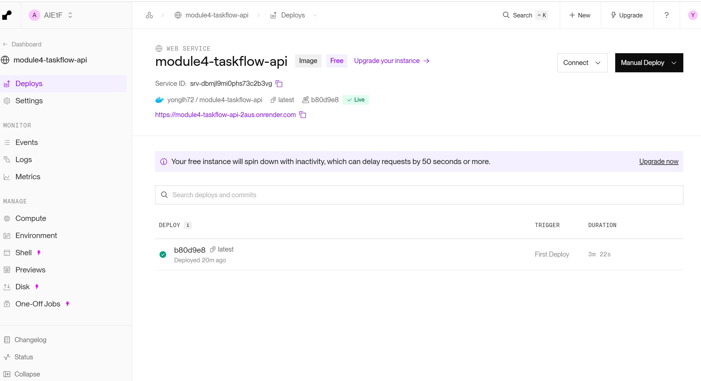
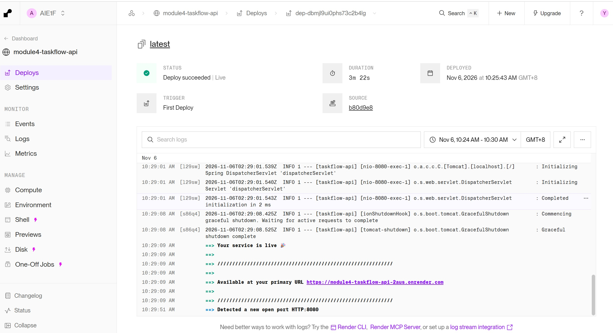
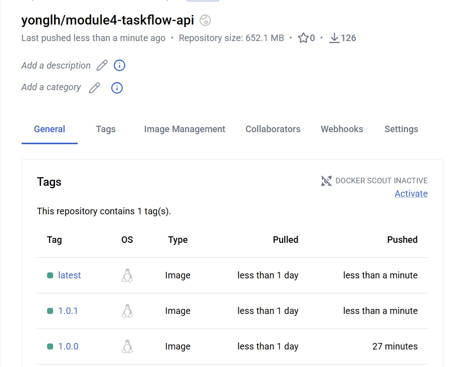

# Taskflow API from Module 3

A Spring Boot REST API for managing tasks. Tasks are stored in memory, so they are cleared when the application restarts.

## How the code is organized

- `TaskflowApiApplication` starts the Spring Boot application and provides the `ChatClient` used for AI summaries.
- `model/Task` defines a task with an ID, title, and completed status.
- `repository/TaskRepository` stores tasks in a `HashMap` and assigns IDs to new tasks.
- `service/TaskService` implements task operations and builds the prompt for task summaries.
- `controller/TaskController` exposes the HTTP endpoints under `/api/tasks`.

## API endpoints

| Method | Path | Description |
| --- | --- | --- |
| `GET` | `/api/tasks` | List all tasks |
| `GET` | `/api/tasks/{id}` | Get a task by ID |
| `POST` | `/api/tasks` | Create a task |
| `PUT` | `/api/tasks/{id}` | Replace a task’s title and completed status |
| `PUT` | `/api/tasks/{id}/complete` | Mark a task as complete |
| `DELETE` | `/api/tasks/{id}` | Delete a task |
| `GET` | `/api/tasks/summary` | Generate a plain-text AI summary of the tasks |

Task JSON has this shape:

```json
{
  "id": 1,
  "title": "Prepare assignment",
  "completed": false
}
```
# Module 4 Assignment
## Render Live Application URL
https://module4-taskflow-api-2aus.onrender.com/api/tasks

## Render Dashboard Screenshots



# Sketch Goal Option 1
Added CI Pipeline using GitHub Action

## GitHub Action Pipeline Run Link
https://github.com/yonglh/module4-taskflow-api/actions/runs/42165743481

## Docker Hub Image Link
https://hub.docker.com/repository/docker/yonglh/module4-taskflow-api/tags

# Sketch Goal Option 2
## Added Front End for the task flow api. 
Frontend url: https://module4-taskflow-api-frontend.netlify.app

# Sketch Goal Option 4
## Docker Image Versioning
The TaskFlow API Docker image uses Semantic Versioning in the format `MAJOR.MINOR.PATCH`:

- **MAJOR**: increment for incompatible API changes.
- **MINOR**: increment for backward-compatible features.
- **PATCH**: increment for backward-compatible bug fixes.

For example, `1.2.3` is major version 1, minor version 2, patch version 3. The CI workflow publishes this versioned tag and also updates `latest` to point to the same image. Use a specific version tag when you need a predictable release; `latest` refers to the most recently published image.

## Docker Hub Screenshots with version tag

